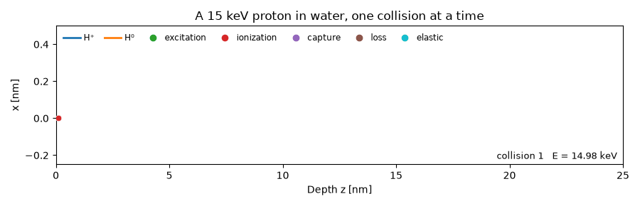
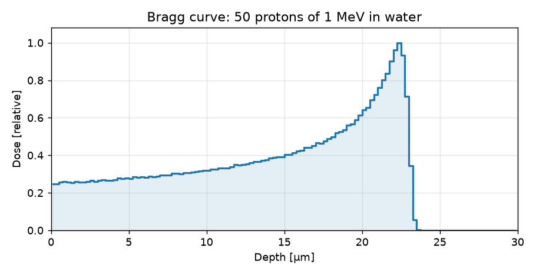
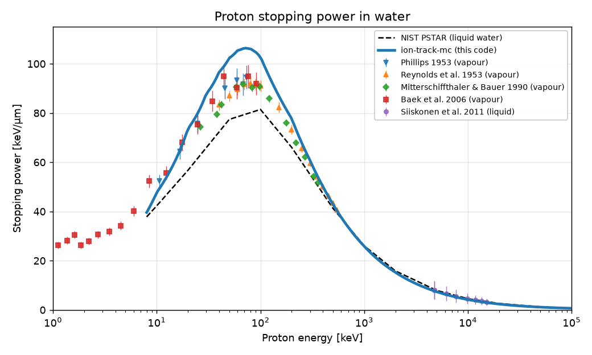
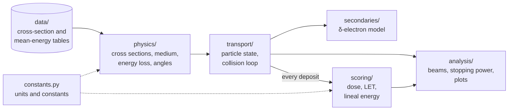
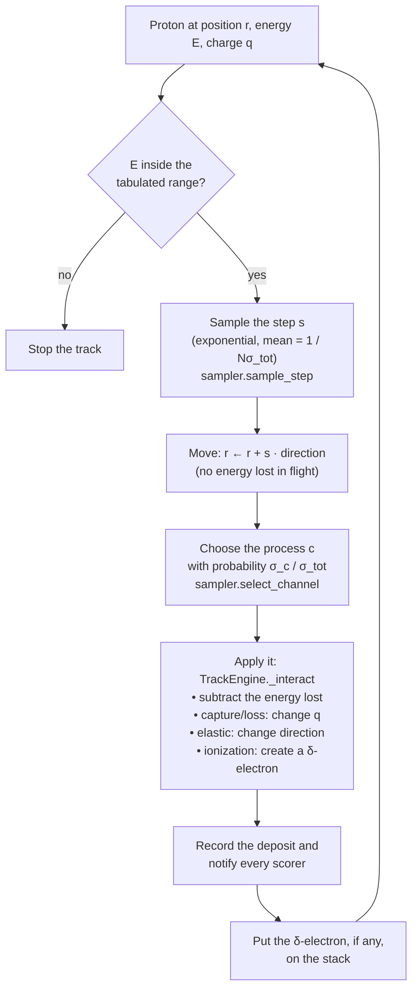

# ion-track-mc

[](https://github.com/juanmontiz/ion-track-mc/actions/workflows/tests.yml)
[](LICENSE)

[](#the-notebooks)

An educational, event-by-event Monte Carlo code that simulates the
**track of a proton in liquid water**, one collision at a time, and turns
the energy it leaves behind into **dose, stopping power, LET and lineal
energy**. It follows the model of the research code **TILDA-V**
(Quinto et al. 2017) and uses its cross sections, in a form small and
readable enough to study line by line.

It was written for a radiobiology course. The aim is that you can open any
file, follow the physics, and see where each number in a plot comes from.

<p align="center">
  
</p>

*The first 25 nm of a 15 keV proton track in water, one collision at a
time: each dot is a collision coloured by process, and the line turns
orange while the proton travels as neutral hydrogen (H⁰) after capturing
an electron. Made with
[`docs/make_track_animation.py`](docs/make_track_animation.py).*

> **En español.** `ion-track-mc` es un código Monte Carlo educativo que
> sigue, colisión por colisión, la traza de un protón en agua líquida y
> calcula dosis, poder de frenado, TEL y energía lineal. Se escribió para
> el curso *Interacción radiación–materia. Aplicación a la radiobiología*
> (Universidad Nacional de Rosario). Los notebooks guiados de los trabajos
> prácticos lo instalan solos en Google Colab y usan las utilidades de
> [`curso/`](curso/). Para usarlo en tu computadora, ver
> [Quick start](#quick-start). El código y su documentación están en inglés;
> hay un [tutorial en diapositivas en español](docs/tutorial/tutorial_es.pdf).

---

## Contents

- [Quick start](#quick-start)
- [What the code simulates](#what-the-code-simulates)
- [The physics model in plain words](#the-physics-model-in-plain-words)
- [Validation: stopping power](#validation-stopping-power)
- [Limitations](#limitations)
- [How the code is organised](#how-the-code-is-organised)
- [Setup](#setup)
- [The notebooks](#the-notebooks)
- [Units](#units)
- [Tests](#tests)
- [Repository layout](#repository-layout)
- [Authors and acknowledgements](#authors-and-acknowledgements)
- [How to cite](#how-to-cite)
- [Further reading](#further-reading)

---

## Quick start

**New to the code?** The [tutorial slides](docs/tutorial/tutorial.pdf)
(26 slides, ~20 min) go from the physics in brief to installing the code,
running a first simulation and reading the results.

**In the browser, nothing to install.** Open any of the three notebooks in
Google Colab with its badge in [The notebooks](#the-notebooks). Its
first cell downloads the repository and installs the package.

**On your computer**, with Python ≥ 3.10:

```bash
git clone https://github.com/juanmontiz/ion-track-mc
cd ion-track-mc
./setup.sh                                   # creates .venv and installs everything
.venv/bin/python notebooks/minimal_script.py # one 1 MeV proton -> bragg_curve.png
.venv/bin/jupyter lab notebooks/             # the notebooks
```

**As a library** in an existing environment (the data tables are
installed with the package):

```bash
pip install git+https://github.com/juanmontiz/ion-track-mc
```

[`notebooks/minimal_script.py`](notebooks/minimal_script.py) is the
shortest complete use of the code: load the tables, attach a depth-dose
scorer, transport one proton, plot. Read it top to bottom: every
simulation in the notebooks follows the same four steps.

## What the code simulates

A proton (H⁺) with an energy from about 10 keV upwards enters a block of
water. On its way it collides with water molecules thousands of times. In
each collision it loses a little energy, may knock out an electron, may
capture an electron and continue as a neutral hydrogen atom (H⁰), or may
be slightly deflected. It slows down until it stops.

The code follows **every one of those collisions individually**. This is
what "event-by-event" or "track-structure" Monte Carlo means. The result is
a list of energy deposits: *how much* energy was left, *where*, and *by
which process*. Everything else is computed from that list:

| Output | What it is | Where it is computed |
|---|---|---|
| Track picture | every collision of one proton, coloured by process | `analysis/visualization.py` |
| Stopping power $S(E)$ | mean energy lost per nm at energy $E$ | `analysis/stopping_power.py` |
| Depth-dose (Bragg) curve | dose vs depth for a beam | `scoring/dose.py`, `analysis/beam.py` |
| Radial dose, 2D dose maps | dose vs distance from the track axis | `scoring/dose.py` |
| LET: $\bar L_T$, $\bar L_D$ | track- and dose-averaged linear energy transfer | `scoring/radiobiology.py` |
| Lineal energy $y$, specific energy $z$ | energy deposited in one small spherical site | `scoring/radiobiology.py` |

<p align="center">
  
</p>

## The physics model in plain words

In seven steps, from the free flight between collisions to the end of
the track.

<details>
<summary><b>Show the seven steps</b></summary>

**1. Collisions are discrete events.** Between two collisions the proton
flies in a straight line and loses no energy. All energy loss happens *at*
collisions. (Codes that use a continuous "slowing-down" approximation work
differently.)

**2. The distance to the next collision is random.** How likely each
process is at energy $E$ is given by its **cross section** $\sigma(E)$: the
effective target area one water molecule presents. Multiplied by the
number of molecules per nm³, $N$, this gives the number of collisions per
nm, $N\sigma_{\text{tot}}$. Its inverse is the **mean free path**. The
actual step is drawn from an exponential distribution with that mean.

**3. Which process happens is random too.** At each collision one of five
processes is chosen, with probability $\sigma_c/\sigma_{\text{tot}}$:

| Process | What happens | Charge state |
|---|---|---|
| **Ionization** | an electron is knocked out of the molecule and flies off (a *δ-electron*) | unchanged |
| **Excitation** | the molecule is left in an excited state | unchanged |
| **Electron capture** | H⁺ takes an electron from the molecule | H⁺ → H⁰ |
| **Electron loss** | H⁰ loses its electron | H⁰ → H⁺ |
| **Elastic scattering** | the projectile is deflected by the nuclei and transfers a little recoil energy | unchanged |

**4. The charge state changes along the track.** A "proton" track is
really a hydrogen ion switching back and forth between H⁺ and H⁰. Each
state has its own cross sections. This matters most at low energy, near
the end of the track.

**5. Energy lost per collision comes from tables.** For each process, the
mean energy left at the collision site and the mean energy carried off by
the δ-electron are read from tabulated data. The cross sections come from
CDW-EIS, Miller–Green and classical models, the same ones TILDA-V uses.

**6. δ-electrons are deposited on the spot.** An ejected electron gives
all its energy to the water at the point where it was created; it is not
transported further (see [Limitations](#limitations)).

**7. The track ends** when the proton's energy falls below the lowest
tabulated energy (8 keV).

</details>

The equations behind each step, with derivations, are in the package
READMEs listed [below](#how-the-code-is-organised).

## Validation: stopping power

The stopping power is not an input of the code: it emerges from the
sampled collisions. The figure compares the model's charge-equilibrium
stopping power (the exact expectation of its collision rules, which the
Monte Carlo reproduces; see the tests) with NIST PSTAR for liquid water and
with the measurements in
[`data_comparison/stopping_power_water/`](data_comparison/stopping_power_water/).

<p align="center">
  
</p>

- **From 0.5 to 2 MeV** the model agrees with PSTAR within 4%.
- **Near the maximum (20–200 keV)** it is 18–32% above PSTAR. The
  measurements there lie between PSTAR and the model, closer to the model:
  the model is about 10–15% above them.
- **Above 5 MeV** it is about 8% below PSTAR.

The gaps come from the input cross sections (computed for water vapour),
not from the sampling: notebook 01, §5–6, discusses them.

<details>
<summary><b>Values at selected energies</b></summary>

| Energy (keV) | Model (keV/µm) | PSTAR (keV/µm) | Model / PSTAR |
|---:|---:|---:|---:|
| 10 | 47.7 | 42.3 | 1.13 |
| 20 | 73.6 | 56.7 | 1.30 |
| 50 | 102.3 | 77.4 | 1.32 |
| 100 | 102.8 | 81.5 | 1.26 |
| 200 | 77.7 | 66.0 | 1.18 |
| 500 | 42.9 | 41.3 | 1.04 |
| 1000 | 25.9 | 26.1 | 0.99 |
| 2000 | 15.3 | 15.9 | 0.96 |
| 5000 | 7.4 | 7.9 | 0.93 |
| 10000 | 4.2 | 4.6 | 0.92 |
| 100000 | 0.7 | 0.7 | 0.92 |

Figure: [`docs/stopping_power_plot.py`](docs/stopping_power_plot.py);
table: [`docs/stopping_power_table.py`](docs/stopping_power_table.py).

</details>

## Limitations

Know these before you interpret a result.

- **Electrons are not transported.** δ-electron energy never leaves the
  track core. Dose very close to the track axis is therefore
  overestimated, and dose far from the axis, which energetic δ-rays would
  carry there, is missing. Quantities integrated over the track, such as
  the Bragg curve and LET, are much less affected. Electron cross sections
  are shipped with the code but not used.
- **Liquid water only**, modelled with cross sections computed for water
  **vapour** (as in TILDA-V). See [Validation](#validation-stopping-power)
  for what this means for the stopping power. There is no tissue, PMMA or
  DNA geometry.
- **Hydrogen projectiles only** (H⁺/H⁰); no heavier ions.
- **Energy range 8 keV to 300 MeV.** Outside the tabulated range the code
  stops rather than extrapolate. Energy left below 8 keV is not deposited,
  which slightly shortens the very end of the track.
- **Mean energy losses.** For ionization, excitation, capture and loss the
  energy lost is the tabulated *mean* at that energy, not a value drawn
  from a distribution. Only elastic scattering has a random energy
  transfer.
- **Elastic scattering and stopping power.** The Monte Carlo includes the
  tiny energy given to the nuclei in elastic collisions; the analytic
  "electronic" stopping power leaves it out by convention. The difference
  is about 0.01–0.1% and is deliberate.
- **No microdosimetric spectra.** The distributions $f(y)$, $d(y)$ and
  radiobiological models built on them (e.g. MKM) are not implemented.
- **It is a teaching code.** It is written to be read and is single-threaded
  Python. A beam of a few hundred protons takes minutes, not seconds.

## How the code is organised

The package `ion_track_mc/` is split by responsibility. Each part only
talks to the others through a small interface, so you can read one without
the rest.



| Package | Responsibility | Read more |
|---|---|---|
| `physics/` | What can happen at energy $E$ and charge $q$, how likely it is (cross sections), how much energy it costs, which way particles fly afterwards. It never moves anything. | [README_physics.md](ion_track_mc/physics/README_physics.md) |
| `transport/` | Moves particles: samples step lengths, picks the process, applies it, follows the proton and every δ-electron until all energy is accounted for. | [README_transport.md](ion_track_mc/transport/README_transport.md) |
| `secondaries/` | What happens to a δ-electron. Currently: it deposits all its energy where it is created. | [README_secondaries.md](ion_track_mc/secondaries/README_secondaries.md) |
| `scoring/` | Watches every deposit as it happens and builds dose grids, radial dose, LET and lineal energy. | [README_scoring.md](ion_track_mc/scoring/README_scoring.md) |
| `analysis/` | Higher-level tools: running a beam, computing stopping power, plotting and saving figures. | [README_analysis.md](ion_track_mc/analysis/README_analysis.md) |
| `constants.py` | Physical constants and the internal unit policy. | [README_constants.md](ion_track_mc/README_constants.md) |
| `data/` | The tabulated input data and its file format. | [README_data_format.md](ion_track_mc/data/README_data_format.md) |

### What happens in one collision

The heart of the code is the loop in `transport/engine.py`
(`TrackEngine._transport_proton`). One pass of the loop is one collision:

<details>
<summary><b>Show the collision loop</b></summary>



</details>

When the proton stops, the δ-electrons on the stack are handed one by one
to the electron model in `secondaries/`, and their deposits are recorded
and scored the same way.

A **beam** (`analysis/beam.py::run_beam`) is many such tracks run on the
same engine. The scorers keep adding up across tracks, so at the end they
hold the dose of the whole beam.

## Setup

You need Python ≥ 3.10. From the repository root, run:

```bash
./setup.sh
```

This creates a virtual environment in `.venv/`, installs the dependencies
(NumPy, SciPy, Matplotlib, Jupyter, pytest) and the package itself, and
registers a Jupyter kernel called `ion_track_mc (.venv)`.

Run it again after every fresh copy or clone of the repository. A virtual
environment contains absolute paths and machine-specific files, so it
cannot be copied between computers.

<details>
<summary><b>The same by hand</b></summary>

```bash
python3 -m venv .venv
source .venv/bin/activate
pip install -r requirements.txt
pip install -e .
python -m ipykernel install --user --name=ion_track_mc --display-name "ion_track_mc (.venv)"
```

</details>

## The notebooks

Open them with `.venv/bin/jupyter lab` and choose the
`ion_track_mc (.venv)` kernel, or in Colab with the badges below. Read them
**in order**. Each one saves its figures as PNG and PDF in
`notebooks/output_01/`, `output_02/` and `output_03/`; these folders are
recreated on every run.

**[01 — Full pipeline walkthrough](notebooks/01_full_pipeline_walkthrough.ipynb)** &nbsp; [](https://colab.research.google.com/github/juanmontiz/ion-track-mc/blob/main/notebooks/01_full_pipeline_walkthrough.ipynb)  
The whole chain on single tracks: cross sections and mean free path, one proton's track, stopping power (Monte Carlo vs analytic, vs NIST PSTAR, vs experiment), charge-state equilibrium, a Bragg curve, and how LET depends on the scale it is measured at. *Run time: ~4 min.*

**[02 — Beam simulation](notebooks/02_beam_simulation.ipynb)** &nbsp; [](https://colab.research.google.com/github/juanmontiz/ion-track-mc/blob/main/notebooks/02_beam_simulation.ipynb)  
A beam of 500 protons at 200 keV/u with a 5% energy spread: beam Bragg curve and radial dose, pencil-beam and broad-beam dose maps, energy-loss spread between protons, beam-averaged LET. *Run time: ~14 min.*

**[03 — Track visualization](notebooks/03_track_visualization.ipynb)** &nbsp; [](https://colab.research.google.com/github/juanmontiz/ion-track-mc/blob/main/notebooks/03_track_visualization.ipynb)  
What a track looks like, collision by collision, at low (15 keV/u) and high (500 keV/u) energy. *Run time: ~10 s.*

Run times are for a typical laptop. Notebook 02 is slow because it simulates every
collision of 500 protons. To get it running quickly, lower `N_PARTICLES`
in its "Beam parameters" cell; the curves will be noisier.

## Units

Inside the code every quantity has one fixed unit: **energy in eV, length
in nm, cross sections in nm², number density in nm⁻³**. Input tables are
converted once, when they are loaded. Dose is reported in Gy. LET in eV/nm
is numerically the same as in keV/µm, the usual unit. Projectile energies
in keV/u (energy per nucleon) equal keV for hydrogen. Details:
[README_constants.md](ion_track_mc/README_constants.md).

## Tests

```bash
.venv/bin/pytest -q
```

The 178 tests take under a minute. They check, among other things, that:

- sampled step lengths follow the exponential law with the right mean free
  path;
- processes are chosen with the right probabilities;
- energy is conserved: everything a beam loses ends up deposited;
- Monte Carlo stopping power agrees with the analytic expectation;
- sampled charge-state fractions agree with the closed-form equilibrium;
- dose, LET and lineal-energy formulas give their textbook values on
  simple cases.

The test files in `tests/` are also short, concrete examples of how each
function is used.

## Repository layout

| Path | Contents |
|---|---|
| [`ion_track_mc/`](ion_track_mc/) | The package, with one README per sub-package and the data tables in `data/` |
| [`notebooks/`](notebooks/) | The three notebooks and `minimal_script.py` |
| [`tests/`](tests/) | The test suite (pytest) |
| [`data_comparison/stopping_power_water/`](data_comparison/stopping_power_water/) | Measured proton stopping powers in water, with references |
| [`docs/`](docs/) | The README figures and animation, and the scripts that make them (`python docs/<script>.py` from the repository root) |
| [`docs/tutorial/`](docs/tutorial/) | The tutorial slides (Marp sources and PDF, English and Spanish); figures from `img/make_figures.py` |
| [`.github/workflows/`](.github/workflows/) | Continuous integration: the tests run on every push (Python 3.10–3.13) |
| [`curso/`](curso/) | Utilities (`tp_utils.py`) used by the guided notebooks of the course practicals |

## Authors and acknowledgements

**Juan Manuel Monti** (Instituto de Física Rosario, CONICET-UNR, and
FCEIA, Universidad Nacional de Rosario) and **Michele Arcangelo Quinto**
(Instituto de Física Rosario, CONICET-UNR).

The collision model and all cross-section and mean-energy tables come
from TILDA-V (Quinto et al. 2017). The code was written for the course
*Interacción radiación–materia. Aplicación a la radiobiología*, taught by
Christophe Champion (Université de Bordeaux), Michele A. Quinto and
Juan M. Monti.

## How to cite

If you use this code, cite the repository (GitHub's "Cite this
repository" button reads [`CITATION.cff`](CITATION.cff)) together with the
model it implements:

- M. A. Quinto, J. M. Monti, P. F. Weck, O. A. Fojón, J. Hanssen,
  R. D. Rivarola, P. Senot and C. Champion, "Monte Carlo simulation of
  proton track structure in biological matter", *Eur. Phys. J. D* **71**,
  130 (2017). [doi:10.1140/epjd/e2017-70709-6](https://doi.org/10.1140/epjd/e2017-70709-6)

## Further reading

- **Package READMEs** (linked [above](#how-the-code-is-organised)): the
  physics and the derivations, package by package.
- [`ion_track_mc/data/README_data_format.md`](ion_track_mc/data/README_data_format.md):
  what is in each data file.
- C. Champion *et al.*, "Water versus DNA: new insights into proton track
  structure modelling in radiobiology and radiotherapy",
  *Phys. Med. Biol.* **60**, 7805 (2015).
- M. E. Alcocer-Ávila, *Monte Carlo modeling of targeted radionuclide
  therapy of micrometastases*, PhD thesis, Université de Bordeaux (2021).
  Chapter III is the source of the charge-state equilibrium and stopping
  power formulas used in `analysis/stopping_power.py`.
- A. Larouze, *Dosimétrie de radioéléments émetteurs alpha pour la
  radiothérapie interne vectorisée*, PhD thesis, Université de Bordeaux
  (2024).

## Licence

MIT, see [LICENSE](LICENSE).
