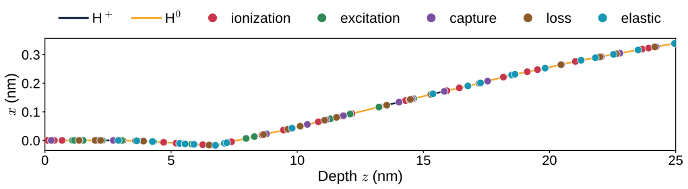
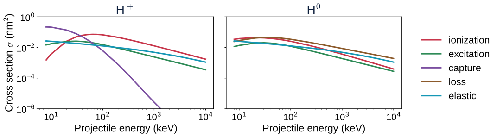
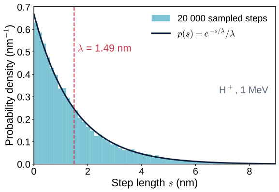
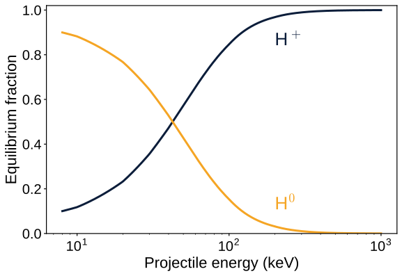
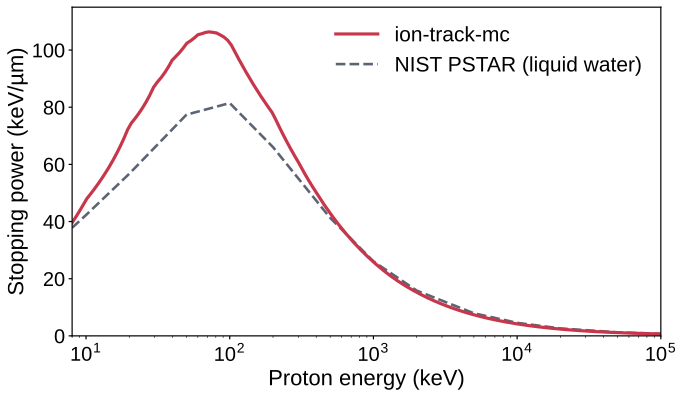
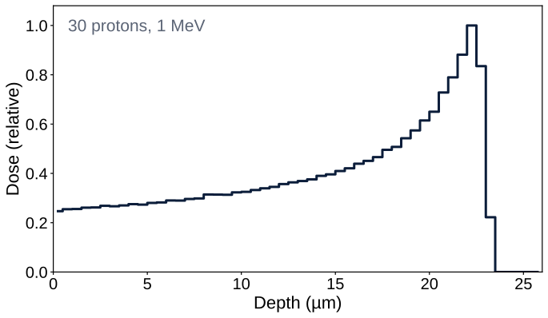
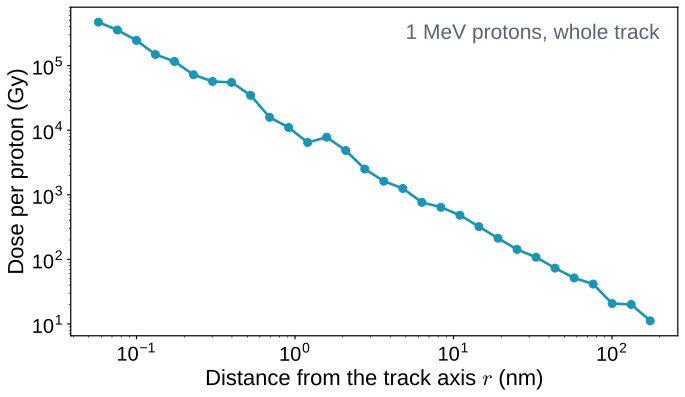

<style>
  section pre {
    font-size: 19px;
    line-height: 1.35;
    background: #f4f6fa;
    border-radius: 10px;
    padding: 12px 18px;
    margin: 8px 0;
  }
  section code { font-family: "Source Code Pro", "DejaVu Sans Mono", monospace; }
  section p code, section li code, section td code {
    background: #f4f6fa;
    border-radius: 5px;
    padding: 1px 6px;
    font-size: 0.88em;
    color: var(--navy-2);
  }
</style>

<!-- _class: lead -->
<!-- _paginate: false -->

# ion-track-mc

## An event-by-event Monte Carlo of proton tracks in water · a hands-on tutorial

**Juan Manuel Monti** · **Michele Arcangelo Quinto**

github.com/juanmontiz/ion-track-mc

---

# Contents

<div class="cols">
<div>

1. **What the code does**
2. **The physics in brief**
   - Cross sections and mean free path
   - Random steps and random processes
   - Charge state, energy loss, δ-electrons
3. **Installation**

</div>
<div>

4. **Your first simulation**
   - The four steps of every run
   - A beam of protons
5. **Reading the results**
   - Stopping power, Bragg curve, radial dose, LET
6. **Limits and next steps**

</div>
</div>

---

<!-- _class: divider -->
<!-- _header: "" -->

# 1 · What the code does

---

<!-- header: What the code does -->

# A proton in water, one collision at a time

<div class="cols-3-2">
<div>

A proton (H⁺) of **10 keV to a few hundred MeV** enters liquid water. On its way it collides with water molecules **thousands of times** until it stops.

The code follows **every collision individually** (*event-by-event* or *track-structure* Monte Carlo) and records each **energy deposit**: how much, where, by which process.

Everything else is computed from that list.

</div>
<div>

| Output | Module |
|---|---|
| Track picture | `analysis/` |
| Stopping power $S(E)$ | `analysis/` |
| Bragg curve, dose maps | `scoring/` |
| Radial dose $D(r)$ | `scoring/` |
| LET $\bar L_T$, $\bar L_D$ | `scoring/` |
| Lineal energy $y$, $z$ | `scoring/` |

</div>
</div>

<div class="box">

Educational code: it follows the model and cross sections of the research code **TILDA-V** (Quinto *et al.* 2017), written to be **read line by line**.

</div>

---

# What "event-by-event" looks like



<div class="cols">
<div>

- Each dot is **one collision**, coloured by process.
- Between collisions the proton flies **straight** and loses **no energy**.

</div>
<div>

- The line turns amber while the projectile travels as **neutral hydrogen** (H⁰) after capturing an electron.

</div>
</div>

<p class="cap">First 25 nm of a 15 keV proton track (586 collisions in total), computed with ion-track-mc.</p>

---

<!-- _class: divider -->
<!-- _header: "" -->

# 2 · The physics in brief

---

<!-- header: The physics in brief -->

# Cross sections and mean free path



<div class="cols">
<div>

$\sigma_c(E)$: effective area one molecule offers to process $c$. With $N$ molecules per nm³ (water: $N \approx 33.4\ \mathrm{nm^{-3}}$), the **mean free path** is

$$\lambda(E) = \frac{1}{N\,\sigma_{\mathrm{tot}}(E)}, \qquad \sigma_{\mathrm{tot}} = \sum_c \sigma_c$$

</div>
<div>

| $E$ | 10 keV | 100 keV | 1 MeV | 10 MeV |
|---|---|---|---|---|
| $\lambda$ (nm) | 0.12 | 0.30 | 1.5 | 9.5 |

</div>
</div>

---

# Step 1 of the loop: how far to the next collision?

<div class="cols">
<div>



</div>
<div>

The distance $s$ to the next collision is **random**, with an exponential law of mean $\lambda$:

$$p(s) = \frac{1}{\lambda}\,e^{-s/\lambda}
\quad\Rightarrow\quad
s = -\lambda \ln \xi,\ \ \xi \in (0,1]$$

The proton moves $s$ in a straight line, **without losing energy**.

<div class="small">

Code: `transport/sampler.py::sample_step`. The histogram is 20 000 calls of that function.

</div>

</div>
</div>

---

# Step 2: which process happens?

At the collision, process $c$ is chosen with probability $P_c = \sigma_c(E)/\sigma_{\mathrm{tot}}(E)$.

| Process | What happens | Charge |
|---|---|---|
| **Ionization** | an electron is knocked out (a *δ-electron*) | unchanged |
| **Excitation** | the molecule is left in an excited state | unchanged |
| **Electron capture** | H⁺ takes an electron from the molecule | H⁺ → H⁰ |
| **Electron loss** | H⁰ loses its electron | H⁰ → H⁺ |
| **Elastic scattering** | deflection by the nuclei, tiny recoil energy | unchanged |

<div class="small">

Code: `transport/sampler.py::select_channel`, then `transport/engine.py::TrackEngine._interact`.

</div>

---

# A "proton" track is really H⁺ and H⁰

<div class="cols">
<div>



</div>
<div>

Capture and loss switch the projectile between **H⁺ and H⁰**; each state has **its own cross sections**.

At high energy capture is rare: the projectile is almost always H⁺. Near the end of the track it spends a large fraction of its path as **H⁰**.

| $E$ (keV) | 10 | 30 | 100 | 300 |
|---|---|---|---|---|
| H⁺ fraction | 0.12 | 0.36 | 0.85 | 0.99 |

</div>
</div>

---

# Step 3: energy loss, δ-electrons, end of the track

<div class="cols">
<div>

- **Energy lost per collision**: the tabulated **mean** value for that process and energy (CDW-EIS, Miller–Green and classical models).
- **Ionization** splits it in two: the binding energy stays at the site; the rest, $W$, leaves with the δ-electron.
- **δ-electrons deposit $W$ on the spot**: they are not transported.
- The track **ends** below 8 keV, the lowest tabulated energy.

</div>
<div>

<div class="key">

**The collision loop**

1. Sample the step $s$, move.
2. Choose the process $c$.
3. Apply it: lose energy, change $q$ or direction, create a δ-electron.
4. Record the deposit and pass it to every **scorer**.

</div>

<div class="small">

Code: `TrackEngine._transport_proton`, about 15 lines.

</div>

</div>
</div>

---

<!-- _class: divider -->
<!-- _header: "" -->

# 3 · Installation

---

<!-- header: Installation -->

# Three ways to get it running

<div class="cards">
<div class="card">

### In the browser

**Nothing to install.** Open a notebook in **Google Colab** with its badge in the README: its first cell downloads and installs the package.

</div>
<div class="card">

### On your computer

With **Python ≥ 3.10**: clone the repository and run `setup.sh`. It creates `.venv/` with everything and a Jupyter kernel.

</div>
<div class="card">

### As a library

In an existing environment, with `pip`. The data tables come with the package.

</div>
</div>

```bash
# on your computer
git clone https://github.com/juanmontiz/ion-track-mc
cd ion-track-mc
./setup.sh            # NumPy, SciPy, Matplotlib, Jupyter, pytest + kernel «ion_track_mc (.venv)»

# as a library
pip install git+https://github.com/juanmontiz/ion-track-mc
```

---

# Check that it works

```bash
.venv/bin/pytest -q                            # 178 tests, under a minute
.venv/bin/python notebooks/minimal_script.py   # one 1 MeV proton -> bragg_curve.png
.venv/bin/jupyter lab notebooks/               # the three notebooks
```

<div class="cols">
<div>

- The tests check, among other things, that **energy is conserved**, steps follow the **exponential law** and processes are chosen with the **right probabilities**.
- The test files in `tests/` are also short **examples of use**.

</div>
<div>

<div class="box">

**A virtual environment cannot be copied** between computers: run `./setup.sh` again after every fresh clone.

</div>

</div>
</div>

---

<!-- _class: divider -->
<!-- _header: "" -->

# 4 · Your first simulation

---

<!-- header: Your first simulation -->

# Every run has four steps: (1) load the tables

```python
from pathlib import Path
import ion_track_mc
from ion_track_mc.physics.channels import Channel
from ion_track_mc.physics.cross_section import (
    TabulatedCrossSectionSet, load_cross_section_table, load_mean_energy_table)

DATA_DIR = Path(ion_track_mc.__file__).parent / "data" / "cross_sections"
FILES = {
    (1, Channel.IONIZATION): "H1+_+_H2O_ionization_TCS_CDW-EIS.dat",
    (1, Channel.CAPTURE):    "H1+_+_H2O_capture_TCS_CDW-EIS.dat",
    # ... 8 tables in total: (charge q, process) -> file
}
xs = TabulatedCrossSectionSet({k: load_cross_section_table(DATA_DIR / f)
                               for k, f in FILES.items()})
edep_tables   = {...}   # mean energy left at the site, per (q, process)
eemean_tables = {...}   # mean δ-electron energy, per q
```

<div class="small">

Copy the complete dictionaries from `notebooks/minimal_script.py`: the shortest complete use of the code.

</div>

---

# (2) choose a scorer · (3) transport · (4) plot

```python
import numpy as np
import matplotlib.pyplot as plt
from ion_track_mc import constants
from ion_track_mc.physics.medium import WATER
from ion_track_mc.transport.engine import TrackEngine
from ion_track_mc.transport.particle import Particle
from ion_track_mc.scoring.dose import make_bragg_curve_scorer
from ion_track_mc.analysis.visualization import plot_bragg_curve

# 2. a scorer watches every deposit: here, dose vs depth
scorer = make_bragg_curve_scorer(WATER, z_edges=np.linspace(-1e9, 1e9, 41),
                                 transverse_half_width_nm=1e9)
# 3. one proton of 1 MeV along +z
engine = TrackEngine(WATER, xs, edep_tables=edep_tables,
                     eemean_tables=eemean_tables, scorers=[scorer], seed=0)
p = Particle(kind="proton", position=np.zeros(3), direction=np.array([0., 0., 1.]),
             energy=1000e3 * constants.PROTON_NUCLEON_COUNT, q=1)
engine.transport(p)
# 4. plot
plot_bragg_curve(scorer); plt.savefig("bragg_curve.png")
```

---

# A beam of protons, and the units

<div class="cols-3-2">
<div>

```python
from ion_track_mc.analysis.beam import run_beam

bragg = make_bragg_curve_scorer(
    WATER, z_edges=np.linspace(0, 26e3, 53),
    transverse_half_width_nm=1e6)
res = run_beam(WATER, xs, edep_tables, eemean_tables,
               n_particles=30, E_beam_eV=1e6,
               E_sigma_eV=0.0, scorers=[bragg], seed=0,
               let_segment_length_nm=1000.0)

dose = bragg.dose_Gy()[0, 0, :]          # Gy per depth bin
print(res.track_averaged_LET(),          # eV/nm
      res.dose_averaged_LET())
```

All tracks feed **the same engine**: the scorers add up the whole beam.

</div>
<div>

| Quantity | Unit inside the code |
|---|---|
| energy | **eV** |
| length | **nm** |
| cross section | **nm²** |
| dose | **Gy** |
| LET | **eV/nm** = keV/µm |

<div class="small">

For hydrogen, keV/u = keV. Fix `seed` to reproduce a run exactly.

</div>

</div>
</div>

---

<!-- _class: divider -->
<!-- _header: "" -->

# 5 · Reading the results

---

<!-- header: Reading the results -->

# Stopping power: it is not an input

<div class="cols-3-2">
<div>



</div>
<div>

$S(E)$ **emerges** from the sampled collisions: mean energy lost per unit path.

- **0.5–2 MeV**: within **4 %** of PSTAR.
- **20–200 keV** (near the maximum): **18–32 % above** PSTAR.
- **Above 5 MeV**: about **8 % below**.

<div class="small">

The gaps come from the input cross sections, computed for water **vapour**; notebook 01, §5–6.

</div>

</div>
</div>

---

# Bragg curve: dose vs depth

<div class="cols-3-2">
<div>



</div>
<div>

The dose **rises slowly** and **peaks just before the end** of the range, where $S(E)$ is largest.

For 1 MeV protons:

- peak at **22.2 µm**;
- NIST CSDA range: **24.6 µm**.

<div class="small">

The model's higher $S$ near the maximum shortens the range a little. With 30 protons the curve is still noisy: more protons, smoother curve, longer run.

</div>

</div>
</div>

---

# Radial dose and LET

<div class="cols-3-2">
<div>



</div>
<div>

$D(r)$: dose vs **distance from the track axis** (`RadialDoseScorer`).

Here it reflects only the **elastic spread** of the proton: δ-electrons are **not transported**, so dose near the axis is **overestimated** and the far tail is **missing**.

LET of the same 30 tracks (1 µm segments):

$$\bar L_T = 42.8, \quad \bar L_D = 50.9\ \ \mathrm{keV/\mu m}$$

</div>
</div>

---

<!-- _class: divider -->
<!-- _header: "" -->

# 6 · Limits and next steps

---

<!-- header: Limits and next steps -->

# Know these before you interpret a result

<div class="cards-2">
<div class="card">

### What it does not do

- **No electron transport**: δ-electrons deposit on the spot.
- **Liquid water only**, with **vapour** cross sections; no tissue or DNA geometry.
- **Hydrogen projectiles only** (H⁺/H⁰).
- **8 keV to 300 MeV**; no extrapolation.

</div>
<div class="card">

### What it simplifies

- **Mean** energy losses (random only for elastic scattering).
- No microdosimetric spectra $f(y)$, $d(y)$.
- **Single-threaded Python**: a few hundred protons take **minutes**.

**Little affected:** quantities integrated over the track, such as the Bragg curve and LET.

</div>
</div>

---

# Where to go next

<div class="cards">
<div class="card">

### 01 · Full pipeline

Cross sections, one track, stopping power vs PSTAR and experiment, charge equilibrium, Bragg curve, LET.

</div>
<div class="card">

### 02 · Beam simulation

500 protons at 200 keV/u: Bragg curve, radial dose, dose maps, beam-averaged LET. *~14 min.*

</div>
<div class="card">

### 03 · Track visualization

Tracks collision by collision at 15 and 500 keV/u. *~10 s.*

</div>
</div>

- **Package READMEs** (`ion_track_mc/*/README_*.md`): the physics and the derivations, package by package.
- **Tests** (`tests/`): concrete examples of every function.

---

<!-- header: "" -->
<!-- _class: lead -->

# How to cite

Cite the repository (GitHub's **«Cite this repository»** button reads `CITATION.cff`) together with the model it implements:

M. A. Quinto, J. M. Monti, P. F. Weck, O. A. Fojón, J. Hanssen, R. D. Rivarola, P. Senot and C. Champion, “Monte Carlo simulation of proton track structure in biological matter”, **Eur. Phys. J. D 71, 130 (2017)**. doi:10.1140/epjd/e2017-70709-6

**github.com/juanmontiz/ion-track-mc** · MIT licence
