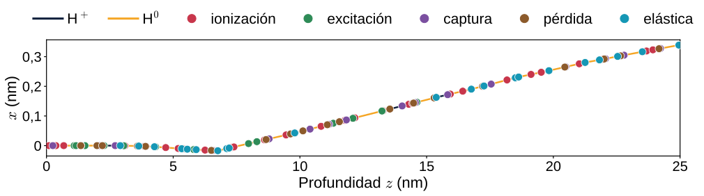
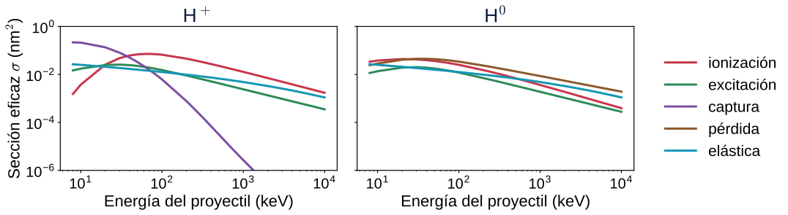
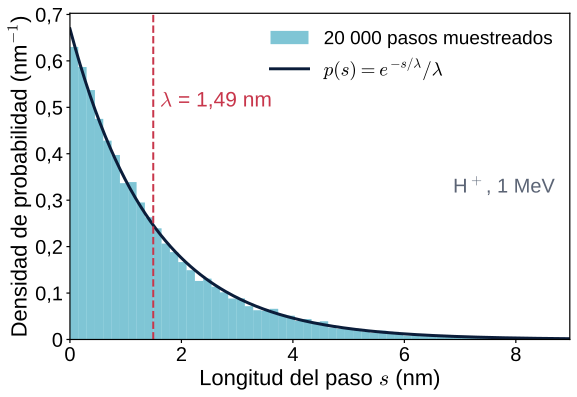
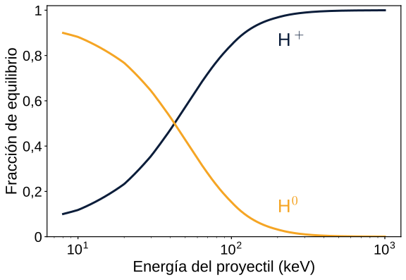
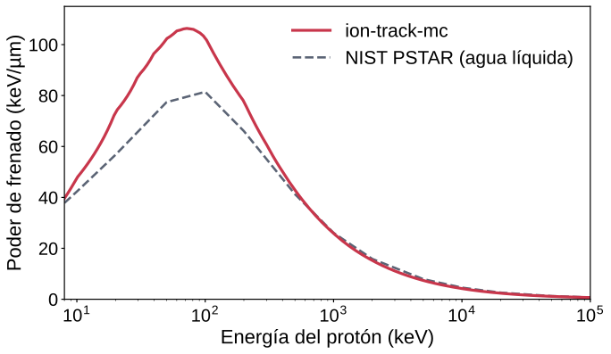
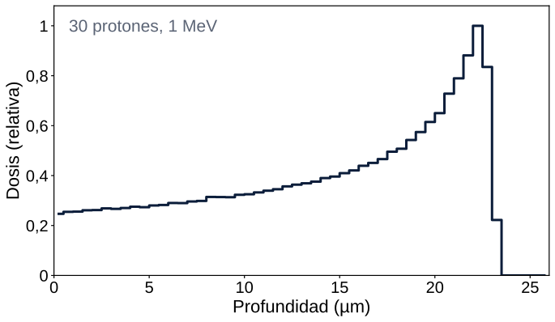
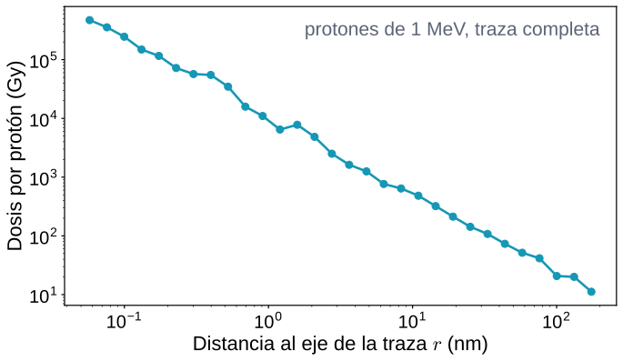

<style>
  section pre {
    font-size: 19px;
    line-height: 1.35;
    background: #f4f6fa;
    border-radius: 10px;
    padding: 12px 18px;
    margin: 8px 0;
  }
  section code { font-family: "Source Code Pro", "DejaVu Sans Mono", monospace; }
  section p code, section li code, section td code {
    background: #f4f6fa;
    border-radius: 5px;
    padding: 1px 6px;
    font-size: 0.88em;
    color: var(--navy-2);
  }
</style>

<!-- _class: lead -->
<!-- _paginate: false -->

# ion-track-mc

## Un Monte Carlo evento por evento de trazas de protones en agua · tutorial práctico

**Juan Manuel Monti** · **Michele Arcangelo Quinto**

github.com/juanmontiz/ion-track-mc

---

# Contenido

<div class="cols">
<div>

1. **Qué hace el código**
2. **La física en breve**
   - Secciones eficaces y camino libre medio
   - Pasos al azar y procesos al azar
   - Estado de carga, pérdida de energía, electrones δ
3. **Instalación**

</div>
<div>

4. **La primera simulación**
   - Los cuatro pasos de toda simulación
   - Un haz de protones
5. **Cómo leer los resultados**
   - Poder de frenado, curva de Bragg, dosis radial, TEL
6. **Límites y próximos pasos**

</div>
</div>

---

<!-- _class: divider -->
<!-- _header: "" -->

# 1 · Qué hace el código

---

<!-- header: Qué hace el código -->

# Un protón en agua, colisión por colisión

<div class="cols-3-2">
<div>

Un protón (H⁺) de **10 keV a unos cientos de MeV** entra en agua líquida. En su camino choca con moléculas de agua **miles de veces**, hasta detenerse.

El código sigue **cada colisión por separado** (Monte Carlo *evento por evento* o de *estructura de trazas*) y registra cada **depósito de energía**: cuánto, dónde y por qué proceso.

Todo lo demás se calcula a partir de esa lista.

</div>
<div>

| Resultado | Módulo |
|---|---|
| Imagen de la traza | `analysis/` |
| Poder de frenado $S(E)$ | `analysis/` |
| Curva de Bragg, mapas de dosis | `scoring/` |
| Dosis radial $D(r)$ | `scoring/` |
| TEL $\bar L_T$, $\bar L_D$ | `scoring/` |
| Energía lineal $y$, $z$ | `scoring/` |

</div>
</div>

<div class="box">

Código educativo: sigue el modelo y las secciones eficaces del código de investigación **TILDA-V** (Quinto *et al.* 2017) y está escrito para **leerse línea por línea**.

</div>

---

# Cómo se ve «evento por evento»



<div class="cols">
<div>

- Cada punto es **una colisión**, coloreada según el proceso.
- Entre colisiones el protón vuela **en línea recta** y **no pierde energía**.

</div>
<div>

- La línea se vuelve ámbar mientras el proyectil viaja como **hidrógeno neutro** (H⁰), después de capturar un electrón.

</div>
</div>

<p class="cap">Primeros 25 nm de la traza de un protón de 15 keV (586 colisiones en total), calculada con ion-track-mc.</p>

---

<!-- _class: divider -->
<!-- _header: "" -->

# 2 · La física en breve

---

<!-- header: La física en breve -->

# Secciones eficaces y camino libre medio



<div class="cols">
<div>

$\sigma_c(E)$: área efectiva que una molécula ofrece al proceso $c$. Con $N$ moléculas por nm³ (agua: $N \approx 33{,}4\ \mathrm{nm^{-3}}$), el **camino libre medio** es

$$\lambda(E) = \frac{1}{N\,\sigma_{\mathrm{tot}}(E)}, \qquad \sigma_{\mathrm{tot}} = \sum_c \sigma_c$$

</div>
<div>

| $E$ | 10 keV | 100 keV | 1 MeV | 10 MeV |
|---|---|---|---|---|
| $\lambda$ (nm) | 0,12 | 0,30 | 1,5 | 9,5 |

</div>
</div>

---

# Paso 1 del ciclo: ¿cuánto hasta la próxima colisión?

<div class="cols">
<div>



</div>
<div>

La distancia $s$ hasta la próxima colisión es **aleatoria**, con ley exponencial de media $\lambda$:

$$p(s) = \frac{1}{\lambda}\,e^{-s/\lambda}
\quad\Rightarrow\quad
s = -\lambda \ln \xi,\ \ \xi \in (0,1]$$

El protón avanza $s$ en línea recta, **sin perder energía**.

<div class="small">

Código: `transport/sampler.py::sample_step`. El histograma son 20 000 llamadas a esa función.

</div>

</div>
</div>

---

# Paso 2: ¿qué proceso ocurre?

En la colisión, el proceso $c$ se elige con probabilidad $P_c = \sigma_c(E)/\sigma_{\mathrm{tot}}(E)$.

| Proceso | Qué ocurre | Carga |
|---|---|---|
| **Ionización** | se arranca un electrón (un *electrón δ*) | no cambia |
| **Excitación** | la molécula queda en un estado excitado | no cambia |
| **Captura electrónica** | el H⁺ toma un electrón de la molécula | H⁺ → H⁰ |
| **Pérdida electrónica** | el H⁰ pierde su electrón | H⁰ → H⁺ |
| **Dispersión elástica** | desviación por los núcleos, energía de retroceso mínima | no cambia |

<div class="small">

Código: `transport/sampler.py::select_channel` y luego `transport/engine.py::TrackEngine._interact`.

</div>

---

# Una traza de «protón» es en realidad H⁺ y H⁰

<div class="cols">
<div>



</div>
<div>

La captura y la pérdida hacen pasar al proyectil de **H⁺ a H⁰** y viceversa; cada estado tiene **sus propias secciones eficaces**.

A energía alta la captura es rara: el proyectil es casi siempre H⁺. Cerca del final de la traza recorre una parte importante de su camino como **H⁰**.

| $E$ (keV) | 10 | 30 | 100 | 300 |
|---|---|---|---|---|
| Fracción de H⁺ | 0,12 | 0,36 | 0,85 | 0,99 |

</div>
</div>

---

# Paso 3: pérdida de energía, electrones δ, fin de la traza

<div class="cols">
<div>

- **Energía perdida por colisión**: el valor **medio** tabulado para ese proceso y esa energía (modelos CDW-EIS, Miller–Green y clásicos).
- La **ionización** la divide en dos: la energía de ligadura queda en el lugar; el resto, $W$, se la lleva el electrón δ.
- **Los electrones δ depositan $W$ en el lugar**: no se transportan.
- La traza **termina** por debajo de 8 keV, la menor energía tabulada.

</div>
<div>

<div class="key">

**El ciclo de colisión**

1. Sortear el paso $s$ y avanzar.
2. Elegir el proceso $c$.
3. Aplicarlo: perder energía, cambiar $q$ o la dirección, crear un electrón δ.
4. Registrar el depósito y pasarlo a cada **contador** (*scorer*).

</div>

<div class="small">

Código: `TrackEngine._transport_proton`, unas 15 líneas.

</div>

</div>
</div>

---

<!-- _class: divider -->
<!-- _header: "" -->

# 3 · Instalación

---

<!-- header: Instalación -->

# Tres maneras de ponerlo a andar

<div class="cards">
<div class="card">

### En el navegador

**Sin instalar nada.** Abrir un notebook en **Google Colab** con su insignia del README: la primera celda descarga e instala el paquete.

</div>
<div class="card">

### En la propia computadora

Con **Python ≥ 3.10**: clonar el repositorio y ejecutar `setup.sh`. Crea `.venv/` con todo lo necesario y un núcleo de Jupyter.

</div>
<div class="card">

### Como biblioteca

En un entorno existente, con `pip`. Las tablas de datos vienen con el paquete.

</div>
</div>

```bash
# en la propia computadora
git clone https://github.com/juanmontiz/ion-track-mc
cd ion-track-mc
./setup.sh            # NumPy, SciPy, Matplotlib, Jupyter, pytest + núcleo «ion_track_mc (.venv)»

# como biblioteca
pip install git+https://github.com/juanmontiz/ion-track-mc
```

---

# Verificar que funciona

```bash
.venv/bin/pytest -q                            # 178 pruebas, menos de un minuto
.venv/bin/python notebooks/minimal_script.py   # un protón de 1 MeV -> bragg_curve.png
.venv/bin/jupyter lab notebooks/               # los tres notebooks
```

<div class="cols">
<div>

- Las pruebas verifican, entre otras cosas, que **se conserve la energía**, que los pasos sigan la **ley exponencial** y que los procesos se elijan con las **probabilidades correctas**.
- Los archivos de `tests/` son además **ejemplos de uso** breves.

</div>
<div>

<div class="box">

**Un entorno virtual no se puede copiar** de una computadora a otra: volver a ejecutar `./setup.sh` después de cada clonado.

</div>

</div>
</div>

---

<!-- _class: divider -->
<!-- _header: "" -->

# 4 · La primera simulación

---

<!-- header: La primera simulación -->

# Toda simulación tiene cuatro pasos: (1) cargar las tablas

```python
from pathlib import Path
import ion_track_mc
from ion_track_mc.physics.channels import Channel
from ion_track_mc.physics.cross_section import (
    TabulatedCrossSectionSet, load_cross_section_table, load_mean_energy_table)

DATA_DIR = Path(ion_track_mc.__file__).parent / "data" / "cross_sections"
FILES = {
    (1, Channel.IONIZATION): "H1+_+_H2O_ionization_TCS_CDW-EIS.dat",
    (1, Channel.CAPTURE):    "H1+_+_H2O_capture_TCS_CDW-EIS.dat",
    # ... 8 tablas en total: (carga q, proceso) -> archivo
}
xs = TabulatedCrossSectionSet({k: load_cross_section_table(DATA_DIR / f)
                               for k, f in FILES.items()})
edep_tables   = {...}   # energía media que queda en el lugar, por (q, proceso)
eemean_tables = {...}   # energía media del electrón δ, por q
```

<div class="small">

Copiar los diccionarios completos de `notebooks/minimal_script.py`, el uso completo más breve del código.

</div>

---

# (2) elegir un contador · (3) transportar · (4) graficar

```python
import numpy as np
import matplotlib.pyplot as plt
from ion_track_mc import constants
from ion_track_mc.physics.medium import WATER
from ion_track_mc.transport.engine import TrackEngine
from ion_track_mc.transport.particle import Particle
from ion_track_mc.scoring.dose import make_bragg_curve_scorer
from ion_track_mc.analysis.visualization import plot_bragg_curve

# 2. un contador recibe cada depósito: aquí, dosis en función de la profundidad
scorer = make_bragg_curve_scorer(WATER, z_edges=np.linspace(-1e9, 1e9, 41),
                                 transverse_half_width_nm=1e9)
# 3. un protón de 1 MeV a lo largo de +z
engine = TrackEngine(WATER, xs, edep_tables=edep_tables,
                     eemean_tables=eemean_tables, scorers=[scorer], seed=0)
p = Particle(kind="proton", position=np.zeros(3), direction=np.array([0., 0., 1.]),
             energy=1000e3 * constants.PROTON_NUCLEON_COUNT, q=1)
engine.transport(p)
# 4. graficar
plot_bragg_curve(scorer); plt.savefig("bragg_curve.png")
```

---

# Un haz de protones, y las unidades

<div class="cols-3-2">
<div>

```python
from ion_track_mc.analysis.beam import run_beam

bragg = make_bragg_curve_scorer(
    WATER, z_edges=np.linspace(0, 26e3, 53),
    transverse_half_width_nm=1e6)
res = run_beam(WATER, xs, edep_tables, eemean_tables,
               n_particles=30, E_beam_eV=1e6,
               E_sigma_eV=0.0, scorers=[bragg], seed=0,
               let_segment_length_nm=1000.0)

dose = bragg.dose_Gy()[0, 0, :]          # Gy por intervalo
print(res.track_averaged_LET(),          # eV/nm
      res.dose_averaged_LET())
```

Todas las trazas alimentan **el mismo motor**: los contadores suman el haz completo.

</div>
<div>

| Magnitud | Unidad dentro del código |
|---|---|
| energía | **eV** |
| longitud | **nm** |
| sección eficaz | **nm²** |
| dosis | **Gy** |
| TEL | **eV/nm** = keV/µm |

<div class="small">

Para el hidrógeno, keV/u = keV. Fijar `seed` para reproducir exactamente una simulación.

</div>

</div>
</div>

---

<!-- _class: divider -->
<!-- _header: "" -->

# 5 · Cómo leer los resultados

---

<!-- header: Cómo leer los resultados -->

# Poder de frenado: no es un dato de entrada

<div class="cols-3-2">
<div>



</div>
<div>

$S(E)$ **surge** de las colisiones sorteadas: energía media perdida por unidad de camino.

- **0,5–2 MeV**: dentro del **4 %** de PSTAR.
- **20–200 keV** (cerca del máximo): **18–32 % por encima** de PSTAR.
- **Por encima de 5 MeV**: alrededor de **8 % por debajo**.

<div class="small">

Las diferencias vienen de las secciones eficaces de entrada, calculadas para **vapor** de agua; notebook 01, §5–6.

</div>

</div>
</div>

---

# Curva de Bragg: dosis en función de la profundidad

<div class="cols-3-2">
<div>



</div>
<div>

La dosis **crece despacio** y **alcanza el máximo justo antes del final** del alcance, donde $S(E)$ es mayor.

Para protones de 1 MeV:

- máximo en **22,2 µm**;
- alcance CSDA del NIST: **24,6 µm**.

<div class="small">

El $S$ más alto del modelo cerca del máximo acorta un poco el alcance. Con 30 protones la curva todavía tiene ruido: más protones, curva más suave y simulación más larga.

</div>

</div>
</div>

---

# Dosis radial y TEL

<div class="cols-3-2">
<div>



</div>
<div>

$D(r)$: dosis en función de la **distancia al eje de la traza** (`RadialDoseScorer`).

Aquí solo refleja la **dispersión elástica** del protón: los electrones δ **no se transportan**, así que la dosis cerca del eje está **sobrestimada** y falta la cola lejana.

TEL de las mismas 30 trazas (segmentos de 1 µm):

$$\bar L_T = 42{,}8, \quad \bar L_D = 50{,}9\ \ \mathrm{keV/\mu m}$$

</div>
</div>

---

<!-- _class: divider -->
<!-- _header: "" -->

# 6 · Límites y próximos pasos

---

<!-- header: Límites y próximos pasos -->

# Tenerlos en cuenta antes de interpretar un resultado

<div class="cards-2">
<div class="card">

### Lo que no hace

- **No transporta electrones**: los electrones δ depositan en el lugar.
- **Solo agua líquida**, con secciones eficaces de **vapor**; sin tejido ni geometría de ADN.
- **Solo proyectiles de hidrógeno** (H⁺/H⁰).
- **De 8 keV a 300 MeV**; no extrapola.

</div>
<div class="card">

### Lo que simplifica

- Pérdidas de energía **medias** (al azar solo en la dispersión elástica).
- Sin espectros microdosimétricos $f(y)$, $d(y)$.
- **Python de un solo hilo**: unos cientos de protones tardan **minutos**.

**Poco afectadas:** las magnitudes integradas sobre la traza, como la curva de Bragg y la TEL.

</div>
</div>

---

# Por dónde seguir

<div class="cards">
<div class="card">

### 01 · Recorrido completo

Secciones eficaces, una traza, poder de frenado frente a PSTAR y a experimentos, equilibrio de carga, curva de Bragg, TEL.

</div>
<div class="card">

### 02 · Simulación de un haz

500 protones de 200 keV/u: curva de Bragg, dosis radial, mapas de dosis, TEL promediada sobre el haz. *~14 min.*

</div>
<div class="card">

### 03 · Visualización de trazas

Trazas colisión por colisión a 15 y 500 keV/u. *~10 s.*

</div>
</div>

- **README de cada paquete** (`ion_track_mc/*/README_*.md`): la física y las deducciones, paquete por paquete (en inglés).
- **Pruebas** (`tests/`): ejemplos concretos de cada función.

---

<!-- header: "" -->
<!-- _class: lead -->

# Cómo citarlo

Citar el repositorio (el botón **«Cite this repository»** de GitHub lee `CITATION.cff`) junto con el modelo que implementa:

M. A. Quinto, J. M. Monti, P. F. Weck, O. A. Fojón, J. Hanssen, R. D. Rivarola, P. Senot y C. Champion, “Monte Carlo simulation of proton track structure in biological matter”, **Eur. Phys. J. D 71, 130 (2017)**. doi:10.1140/epjd/e2017-70709-6

**github.com/juanmontiz/ion-track-mc** · licencia MIT
